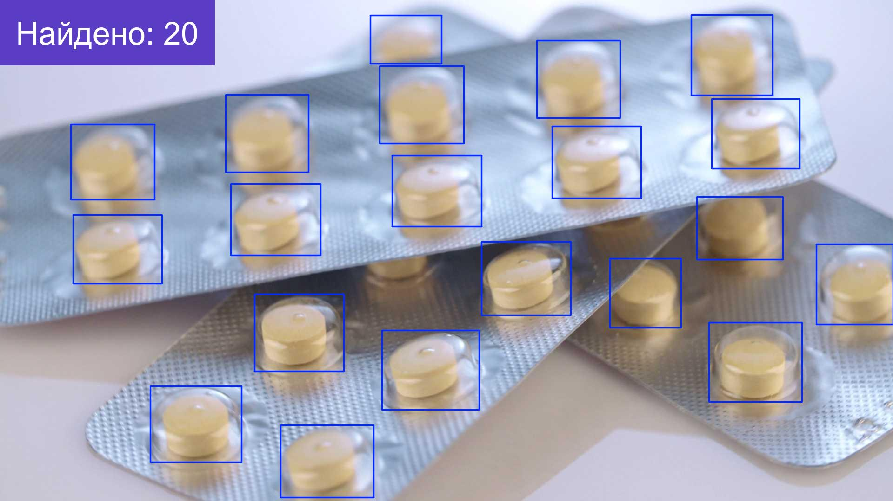
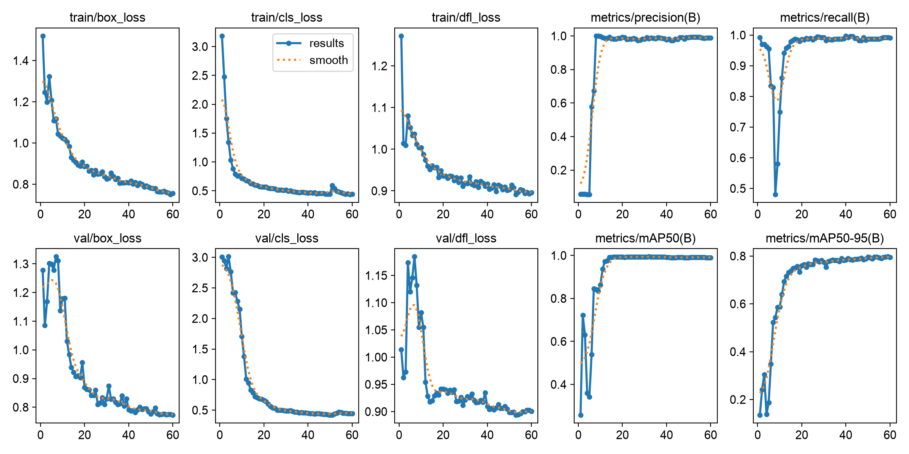

# Подсчёт объектов на фото с YOLO11

Демо-проект: дообучение модели YOLO11n, которая находит и считает таблетки на фото упаковок, и скрипт, который обрабатывает папку с фото и выгружает количество объектов по каждому фото в Excel.

## Результат

На 23 проверочных фото (399 объектов), которые модель не видела при обучении:

| mAP50 | mAP50-95 | Precision | Recall |
|---|---|---|---|
| 0,991 | 0,797 | 0,988 | 0,992 |

Сверка подсчёта с эталонной разметкой: на 17 фото из 23 количество совпало точно, на остальных ошибка в один объект.



## Обучение

- Модель: YOLO11n, 2,6 млн параметров, дообучение с весов, предобученных на COCO.
- Данные: открытый датасет Ultralytics medical-pills — 92 фото для обучения, 23 для проверки, 1 класс.
- Параметры: 60 эпох, вход 640×640, батч 16, оптимизатор AdamW (скорость обучения 0,002 подобрана автоматически).
- Обучение на процессоре AMD Ryzen 7 4800H заняло 22 минуты.



Веса обученной модели — `weights/best.pt`.

## Запуск

```
pip install -r requirements.txt
python train.py
python count.py weights/best.pt папка_с_фото
```

Без папки скрипт подсчёта возьмёт проверочные фото датасета. Результат — фото с рамками и подписью «Найдено: N» и таблица `Подсчёт.xlsx` в папке `results`.

## Лицензия

AGPL-3.0: на этой лицензии распространяются Ultralytics YOLO и датасет medical-pills.
